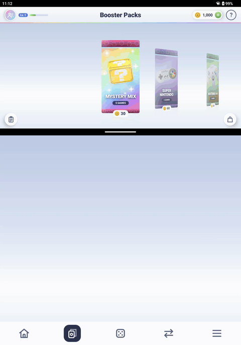

# Gacha Launcher

A game launcher for the AYN Thor. Your ROMs are cards. You don't pick what to play, you pull it.

**[Download the latest APK](https://github.com/adthing/gacha-tcg-launcher/releases/latest)**

Open packs, put your favorites on a shelf of three, and spend golden coins on more room. Everything runs on your own library; nothing is downloaded and nothing costs real money (for now).

## Features

- **Booster packs.** One pack per system, plus a Mystery Mix. Tear one open, discover 5 random games, and swipe the keepers onto your shelf! The rest are discarded.
- **Game shelf.** Starts with 3 slots. Tap a game to launch it in its emulator.
- **Slot machine.** Go to the casino and win big! Land on a game and it launches. You can also win coins, free spins, tickets, coin boosts, mystery boxes or an extra shelf slot!
- **Shell game.** Discarded games come back in sets of five. Pick a set, watch the shuffle, pick a card, and maybe take it home!
- **Economy.** Golden coins trickle in while you're away (up to 8 hours' worth). Spend them on packs, spins, shell games and shelf slots. There's a shop.
- **Missions and levels.** Daily missions, free tickets, XP and level-up rewards.
- **Gamepad or touch.** D-pad, A, B, L1 and R1 work everywhere.

## Requirements

- An **AYN Thor** (Android 13, dual screen).
- **Cocoon** installed and run at least once, with your collection scraped. Gacha Launcher reads its box art from `/sdcard/cocoon/downloaded_media/<system>/icon` (and `hero` for the shelf). It doesn't scrape anything itself, and games without art can't be pulled.
- **Emulators installed**, none are bundled.
- ROMs in `/sdcard/ROMS`, in the usual folders: `snes`, `n64`, `SMD`, `psx`, `psp`, `ps2`, `GameCube`, etc.

## Install

1. Download the latest APK from the [releases page](https://github.com/adthing/gacha-tcg-launcher/releases/latest), and install it.
2. Open it and grant **All files access** when asked.
3. If your ROMs or Cocoon media live elsewhere, set the folders in **Settings** and rescan.

Optional: pick a pack theme in Settings to use Cocoon's theme art on the packs.
